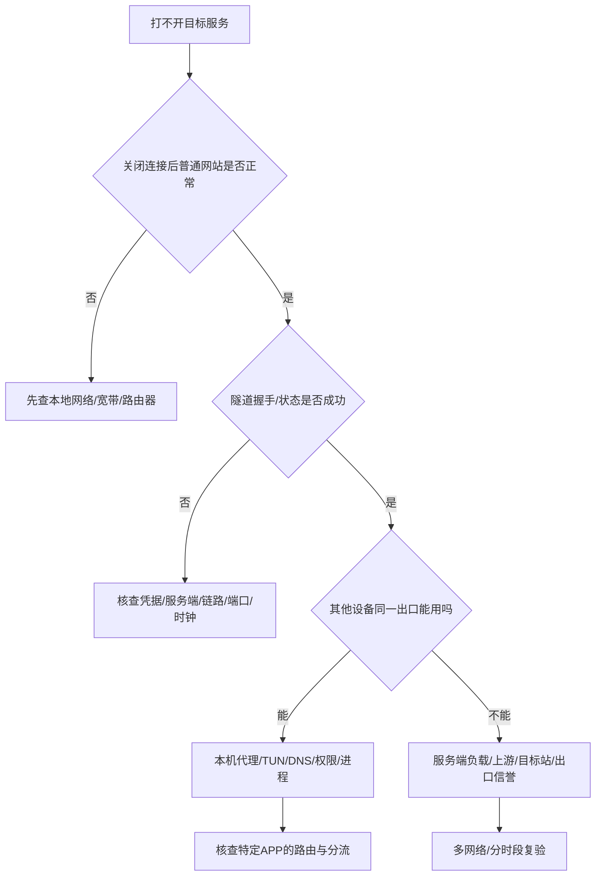

# 21｜五分钟场景化排障：按现象定位，不盲目换节点

**本章结果：**故障发生后，5 分钟内把问题归入一个可操作的范围；严重故障先回退。

## 第零关：不要让诊断造成更大损失

停止在生产设备上反复安装未知软件；不要公开全量日志/订阅密钥。先保存异常时间、网络、操作系统、软件版本和最后一次正常工作时间。

## 决策树

## 8 个场景的优先级

| 症状 | 第一检查项 | 第二检查项 | 不要马上做 |
|---|---|---|---|
| 已连接但没有流量 | 是否有路由及 DNS；应用是否走该隧道 | VPS/出口的上游可用性 | 换一套随机教程 |
| 只在晚上变慢 | 家宽与手机热点 A/B、p95 延迟、时段 | 运营商拥塞/服务商容量 | 说“某国节点永远最快” |
| Git 能用、浏览器不能 | 浏览器代理/DNS/安全插件 | 证书链、本机时间 | 关掉 TLS 证书校验 |
| 浏览器能用、终端 CLI 不能 | shell `HTTPS_PROXY`/应用自己的代理 | TUN 作用范围 | 给未知工具管理员权限 |
| Wi-Fi 行、5G 不行 | 网络接入对照、UDP 支持、IPv6 | 热点与不同运营商 | 直接判定服务器被封 |
| 一开 TUN 内网/NAS 不通 | 本地网段路由、Allow LAN | DNS split horizon | 永久关闭安全防护 |
| iPhone 没有下载入口 | App 所在地区、系统版本、产品官方发行渠道 | 设备区域政策 | 向陌生人交 Apple ID |
| AI 平台登录风控 | 账号真实注册条件、异常登录通知 | 稳定的授权网络和 MFA | 伪造身份或绕过审核 |

## 排障卡记录格式

**时间**：YYYY-MM-DD HH:MM，北京时间。**设备**：Mac M 系列/macOS 版本。**接入**：家宽/移动热点（不写住址）。**现象**：隧道握手成功，但目标 HTTPS 超时。**对照实验**：关闭 TUN 能恢复普通网络；手机热点与家宽不同。**最小变更**：只改一个参数。**结论等级**：已复现/高度怀疑/未确认。**回退**：如何复原。

**完成标准**：证据足够定位失败层级，或按回滚卡恢复业务后再查；不必每次都当场修复根因。
